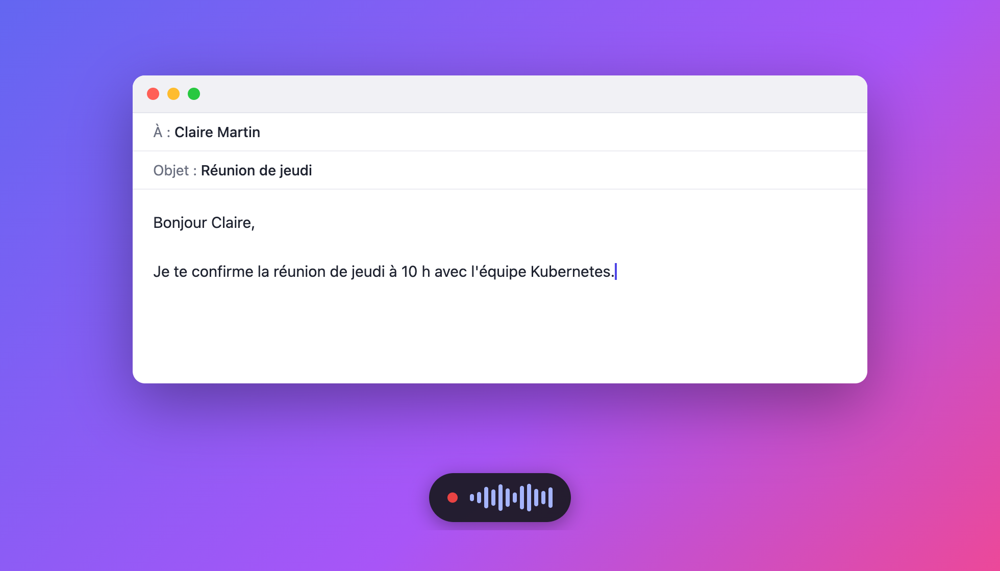
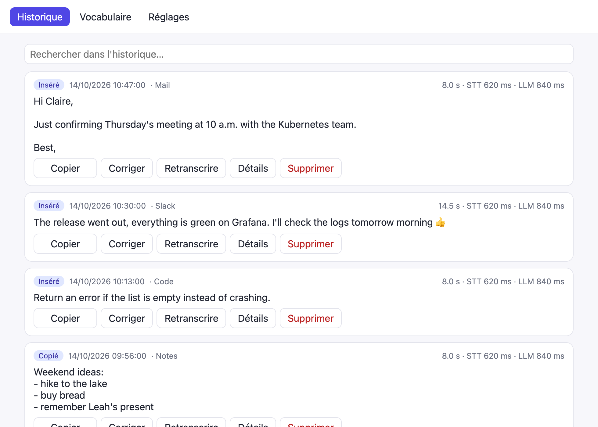
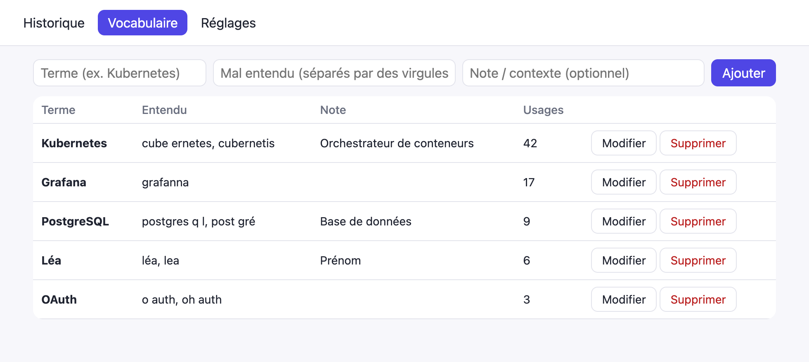
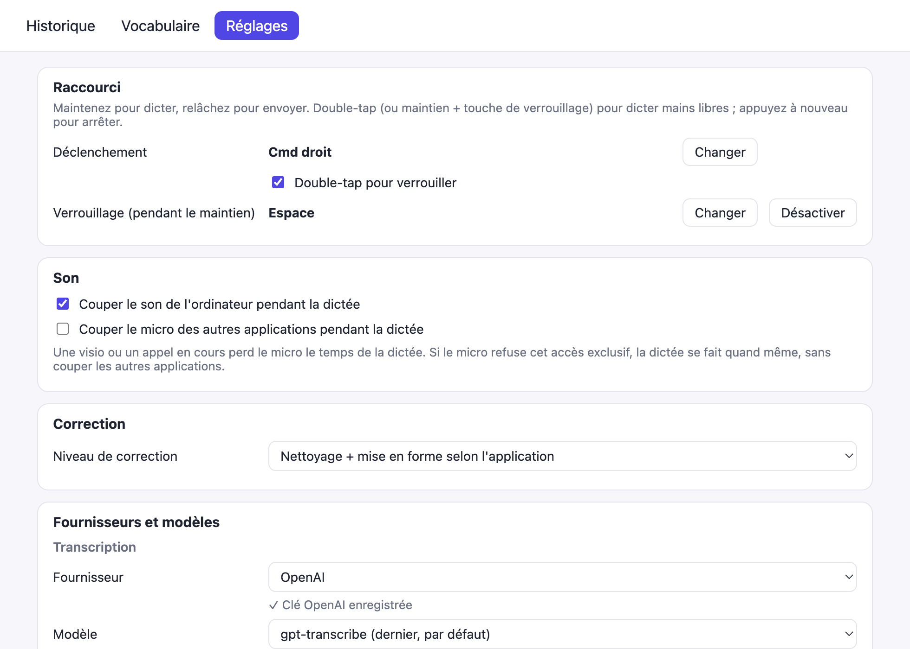
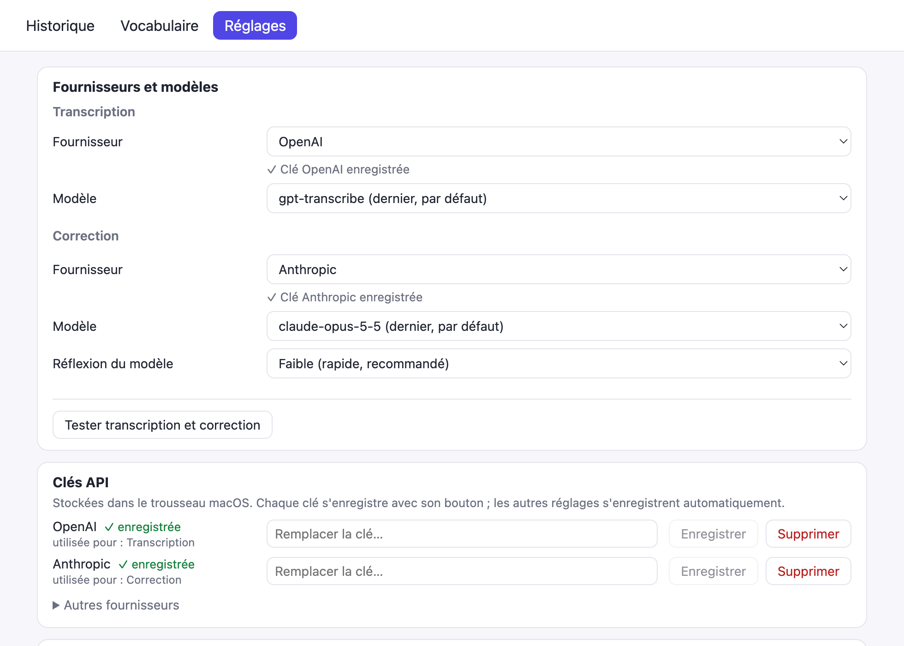

# Scribe

**Voice dictation for Windows and macOS: hold a key, speak, release. Clean, punctuated text lands wherever you were
typing.**

Mail, Slack, Word, VS Code, browser, terminal: Scribe works in any application, with no extension and no
copy-paste. One AI transcribes your voice, another removes the "uh"s and fixes punctuation and the spelling of the
names you taught it.



[**⬇ Download the latest version**](https://github.com/ghusse/scribe/releases/latest)

> Scribe's interface is in French. Dictation works in any language your speech-to-text model supports.

## Why Scribe

- **Everywhere.** Text goes into the focused field of any application. With no field, it is copied to the clipboard
  and a toast tells you so.
- **Quick to trigger.** Hold Right Ctrl (Right Cmd on a Mac) to speak, or double-tap it to dictate hands-free. The
  shortcut can be changed to any combination you like.
- **Text you don't need to fix.** The AI cleans up punctuation, hesitations and vocabulary, and formats the text.
  Start with a keyword ("Slack, …", "Mail, …") to apply a style: an email is not written like a Slack message.
  Styles are yours to edit or create.
- **Your vocabulary.** The Vocabulaire (vocabulary) tab teaches Scribe the names and jargon of your field
  ("Kubernetes", not "cube ernetes").
- **Nothing gets lost.** The history keeps every dictation; network error? « Retranscrire » runs it again from the
  recording.
- **Your keys, your providers.** OpenAI, Anthropic, Mistral or Groq: you pick the model and pay the provider
  directly, per use. No Scribe account, no subscription, no telemetry.
- **Unobtrusive.** A small pill shows the recording and never steals focus. Optionally, mute the computer's sound
  and other applications' microphone while you dictate.
- **Free software** (AGPL-3.0), updated automatically.

| History | Vocabulary | Settings |
|---|---|---|
|  |  |  |

## Installation

Download the installer for your system from the
[latest release](https://github.com/ghusse/scribe/releases/latest):

| System | File |
|---|---|
| Windows 10 / 11 (x64) | `Scribe_<version>_x64-setup.exe` (recommended) or `Scribe_<version>_x64_en-US.msi` |
| macOS 11 or later (Apple Silicon and Intel) | `Scribe_<version>_universal.dmg` |

> **Why a warning during installation?** Scribe is free, open-source software: its installers are not signed with
> a paid certificate (Microsoft Authenticode, Apple notarization), so Windows and macOS warn you on first launch.
> The installers are built by GitHub Actions straight from this repository's source code (details in
> [PRIVACY.md](PRIVACY.md)). Updates, on the other hand, are signed and verified by Scribe.

### Windows

1. Run `Scribe_<version>_x64-setup.exe`.
2. SmartScreen shows "Windows protected your PC": click **More info**, then **Run anyway**.
3. Finish the installation. Scribe opens and settles in the notification area (next to the clock).

### macOS

1. Open the `.dmg` and drag **Scribe** into **Applications**.
2. On first launch, macOS refuses to open the app ("unidentified developer" or "cannot be verified"). Open
   **System Settings > Privacy & Security**, scroll down to the message about Scribe, click **Open Anyway** and
   confirm. On older macOS versions, right-click Scribe > **Open** is enough.

   Command-line alternative:

   ```bash
   xattr -dr com.apple.quarantine /Applications/Scribe.app
   ```

3. Scribe asks for two permissions, granted from its window:
   - **Accessibility**: detect the shortcut, paste the text and check that it landed;
   - **Microphone**: record the dictation.

Scribe lives in the menu bar, with no Dock icon.

> After an update on macOS, the Accessibility permission may no longer be honoured even though Scribe is still
> ticked. Scribe's window tells you: click **Autoriser**, then switch Scribe back on in System Settings.

## Setup: API keys

Scribe uses two AI services, with your own keys:

- **Transcription** (voice to text): OpenAI, Mistral or Groq;
- **Correction** (text to clean text): OpenAI, Anthropic, Mistral or Groq. Optional: unchecking « Corriger et mettre
  en forme avec l'IA » (correct and format with AI) skips it.

One key is enough to get started: OpenAI, Mistral and Groq do both.

### 1. Create a key

| Provider | Transcription | Correction | Where to create the key |
|---|:---:|:---:|---|
| OpenAI | ✓ | ✓ | [platform.openai.com/api-keys](https://platform.openai.com/api-keys) |
| Anthropic | | ✓ | [console.anthropic.com/settings/keys](https://console.anthropic.com/settings/keys) |
| Mistral | ✓ | ✓ | [console.mistral.ai/api-keys](https://console.mistral.ai/api-keys) |
| Groq | ✓ | ✓ | [console.groq.com/keys](https://console.groq.com/keys) |

These are pay-per-use APIs (Groq and Mistral offer a limited free tier): add a payment method or credit to the
provider account, or the key will be rejected. A dictation of a few sentences costs a fraction of a cent.

### 2. Enter it in Scribe

On first launch, Scribe opens on the **Réglages** (settings) tab:

1. **Fournisseurs et modèles** (providers and models): pick the transcription provider and model, then the
   correction ones. Defaults: OpenAI `gpt-transcribe` for transcription, Anthropic `claude-opus-5-5` for correction.
2. **Clés API** (API keys): paste the key of each chosen provider.
3. Click **Tester transcription et correction** (test transcription and correction): Scribe checks both steps and
   shows the details if something fails.

Keys are stored in your system's credential store (Windows Credential Manager, macOS Keychain), never in a file.



## Usage

| Gesture | Effect |
|---|---|
| **Hold** Right Ctrl (Right Cmd on a Mac) | Records while the key is held; releasing transcribes and inserts. |
| **Double-tap** the key | Locked, hands-free mode; press again to stop. |
| **Space** while holding | Locks the current dictation. |

- **Change the shortcut**: Réglages > Raccourci > Changer, then press the combination you want (1 to 4 keys, for
  example `Ctrl + Shift + A` or `Win + Alt`) and release.
- **Vocabulary**: add names, brands and technical terms, with the ways they get misheard. Scribe passes them to
  transcription and correction.
- **History**: find, copy or re-transcribe a dictation. Audio recordings are deleted after the retention period
  chosen in the settings.
- **Startup**: Réglages > Démarrage > « Lancer Scribe à l'ouverture de session » starts it in the background at
  every login.
- **Pause**: from the notification area icon (menu bar on a Mac), to disable the shortcut.

Closing the window does not quit Scribe: it stays in the notification area. To quit, use its icon.

## Updates

Scribe checks for a new version 30 seconds after launch and tells you with a toast. Réglages > Mises à jour installs
it and restarts Scribe. Every update is signed and verified before installation.

## Privacy

No telemetry, no analytics, no account. Your dictations' audio and text go straight from your computer to the
providers you chose, with your key; the history, vocabulary and settings stay on your machine. Everything Scribe
sends and the system access it uses (keyboard, clipboard, focused field) are detailed in [PRIVACY.md](PRIVACY.md).

## Contributing

Bugs and ideas: [open an issue](https://github.com/ghusse/scribe/issues). To build Scribe, run the tests or submit a
change, see [CONTRIBUTING.md](CONTRIBUTING.md).

## License

Copyright (C) 2026 Guillaume Gautreau.

Scribe is distributed under the [GNU Affero General Public License v3.0](LICENSE) (`AGPL-3.0-only`). You may use,
study, modify and redistribute it; any modified version distributed or made available to users, including through
an online service, must be released under the same license, with its complete source code.
